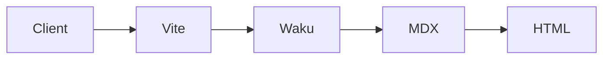
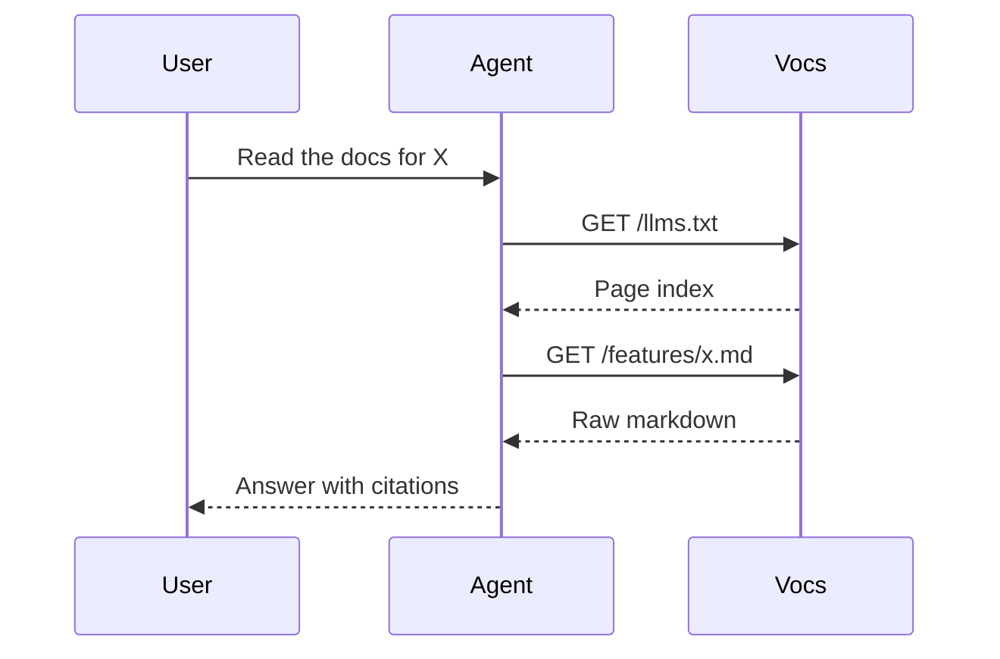
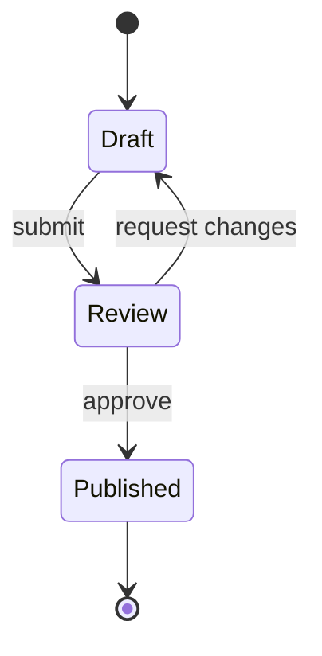
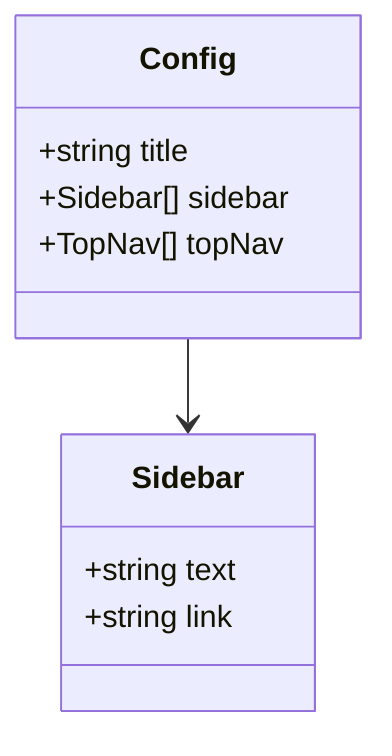

import { Card, Cards } from 'vocs'

# Mermaid Diagrams [Compile diagrams from text to SVG at build time]

## Usage

Write Mermaid syntax inside a `mermaid` code block:

````mdx

````

Vocs compiles the block to an SVG diagram at build time with [Ondine](https://ondine.sh). Pages ship the SVG, not a diagram renderer, and the diagram follows the light/dark color scheme:


## Supported Diagrams

Ondine accepts the same syntax as Mermaid, including:

- **Flowcharts** (`graph`, `flowchart`)
- **Sequence diagrams**
- **Class diagrams**
- **State diagrams**
- **Entity-relationship diagrams**
- **Gantt charts**
- **Pie charts**
- **Git graphs**
- **Mindmaps**
- **Timeline**
- **Quadrant charts**
- **C4 diagrams**

See the [Mermaid documentation](https://mermaid.js.org/intro/) for the syntax reference, and the [Ondine documentation](https://ondine.sh) for every supported diagram type.

## Examples

### Sequence Diagram

:::code-group
<div data-title="Preview">

</div>

```text [Code]
sequenceDiagram
  participant U as User
  participant A as Agent
  participant V as Vocs

  U->>A: Read the docs for X
  A->>V: GET /llms.txt
  V-->>A: Page index
  A->>V: GET /features/x.md
  V-->>A: Raw markdown
  A-->>U: Answer with citations
```
:::

### State Diagram

:::code-group
<div data-title="Preview">

</div>

```text [Code]
stateDiagram-v2
  [*] --> Draft
  Draft --> Review: submit
  Review --> Published: approve
  Review --> Draft: request changes
  Published --> [*]
```
:::

### Class Diagram

:::code-group
<div data-title="Preview">

</div>

```text [Code]
classDiagram
  class Config {
    +string title
    +Sidebar[] sidebar
    +TopNav[] topNav
  }
  class Sidebar {
    +string text
    +string link
  }
  Config --> Sidebar
```
:::

## Theming

Each diagram reads its colors, font, corners, and strokes from `--ondine-*` CSS custom properties. Vocs sets the colors and font from its theme, so diagrams match the page in both color schemes. Override any property in your `_root.css`:

```css [src/pages/_root.css]
/* Rounds node corners and draws thinner strokes */
.ondine {
  --ondine-radius: 6px;
  --ondine-stroke: 1.5px;
}
```

See [Ondine theming](https://ondine.sh/docs/guides/theming) for the full list of properties.

## How It Works

The remark pipeline replaces each `mermaid` code block with a `<div class="ondine-diagram">` that contains the compiled `<svg>`. No diagram code runs in the browser. Markdown exports, such as per-page `.md` files and `llms.txt`, keep the original `mermaid` code block.

A diagram that fails to compile stops the build with an error that names the file, line, and column.

## See More

<Cards>
  <Card
    title="Markdown Extensions"
    description="Callouts, file trees, tabs, and other MDX extensions."
    icon="file-text"
    to="/writing/markdown-extensions"
  />
  <Card
    title="Code & Syntax Highlighting"
    description="Shiki transformers, line focus, diffs, and Twoslash for regular code blocks."
    icon="code"
    to="/writing/syntax-highlighting"
  />
</Cards>
